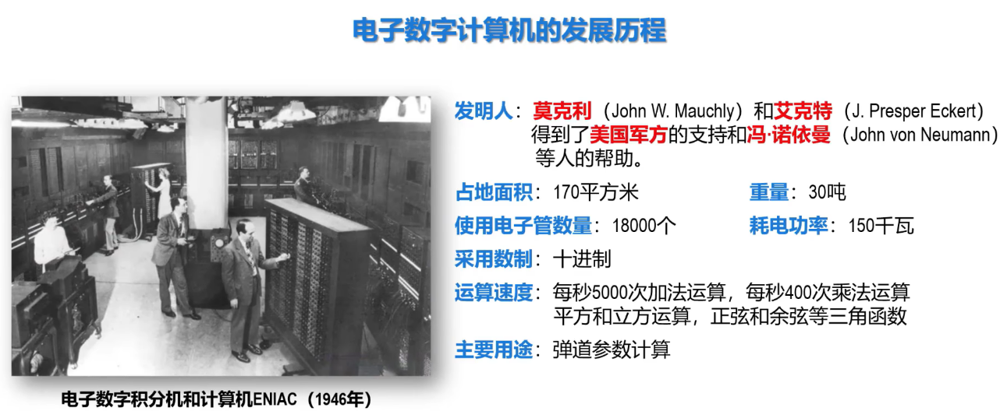
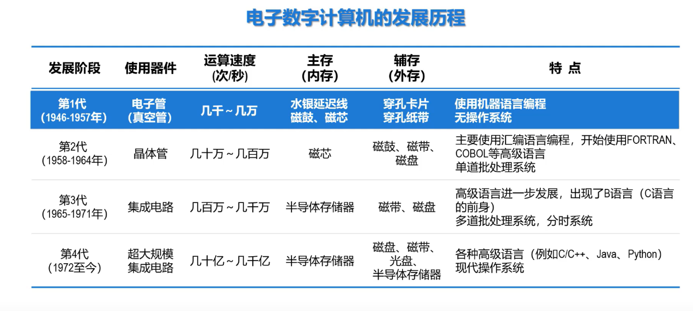
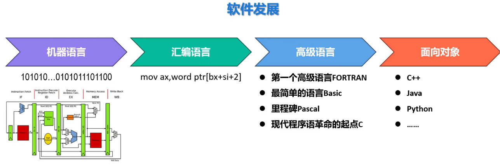

## 一、第一台真正意义上的计算机
阿塔纳索夫-贝瑞计算机（ABC）

## 二、第一台真正实用的电子数学计算机
在**ABC**计算机的基础上发展而来：

## 三、电子数学计算机的总体发展

**摩尔定律**：对于集成电路行业，每过18或者24个月，集成电路上可容纳的晶体管的数量便会翻一番

**摩尔定律**的失效：随着集成电路行业的工艺遇到瓶颈，摩尔定律正在失效

## 三、计算机软件的发展

