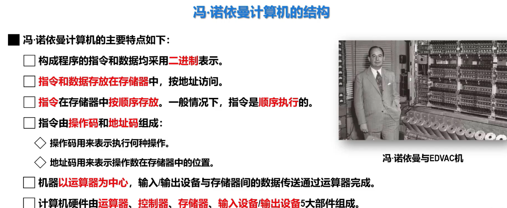
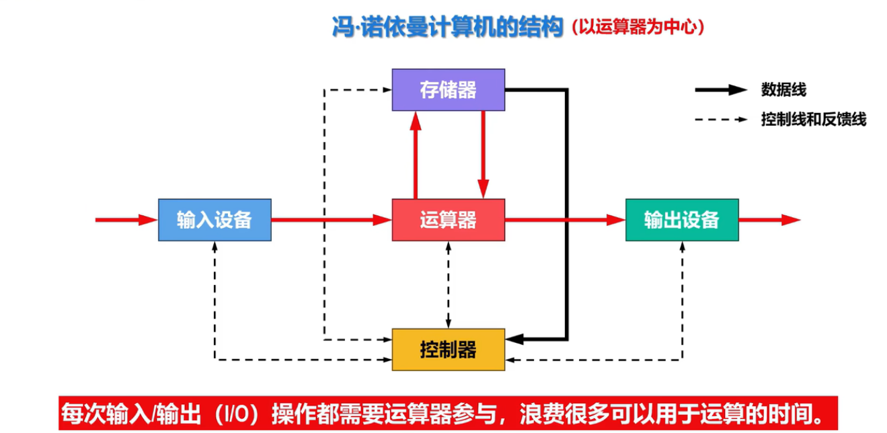
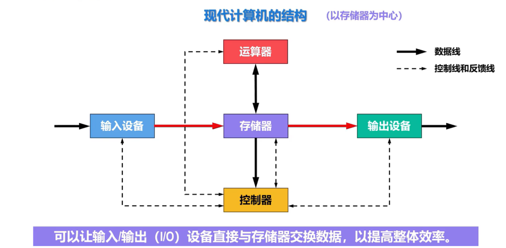
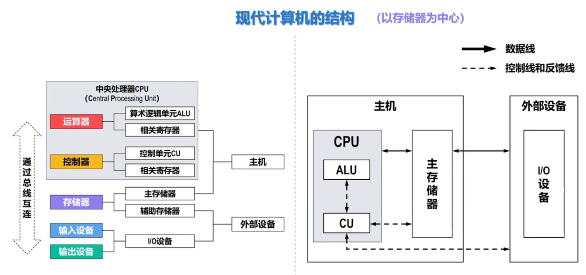

## 一、冯·诺依曼计算机结构
### 1.1 最基本特点

**存储程序**：程序由穿孔介质输入机器，而后长期存储

### 1.2 冯·诺依曼计算机特点

### 1.3 以运算器为中心的冯诺依曼计算机、以存储器为中心的现代计算机

**运算器**为中心

**存储器**为中心

## 二、现代计算机结构

**注**：
- **外设组成**：输入与输出设备、辅助存储器（辅存或外存）（上图右侧有歧义）
- **运算器功能**：算数运算（加减乘除）以及逻辑运算（与、或、非、异或、移位等）