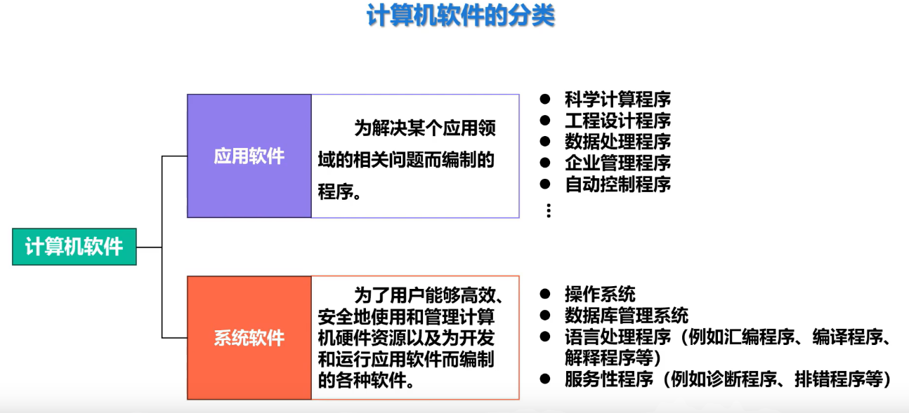
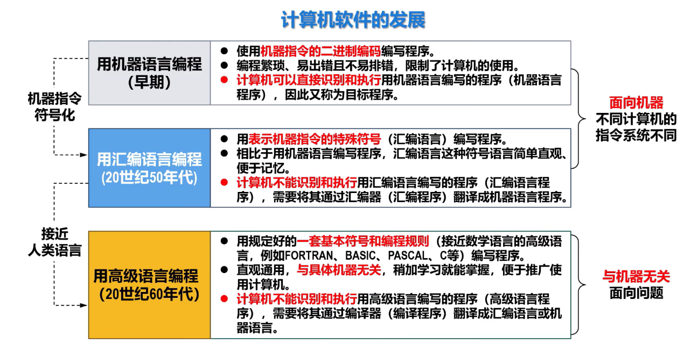
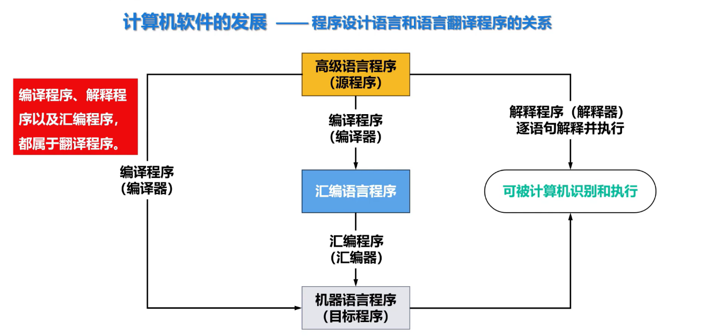
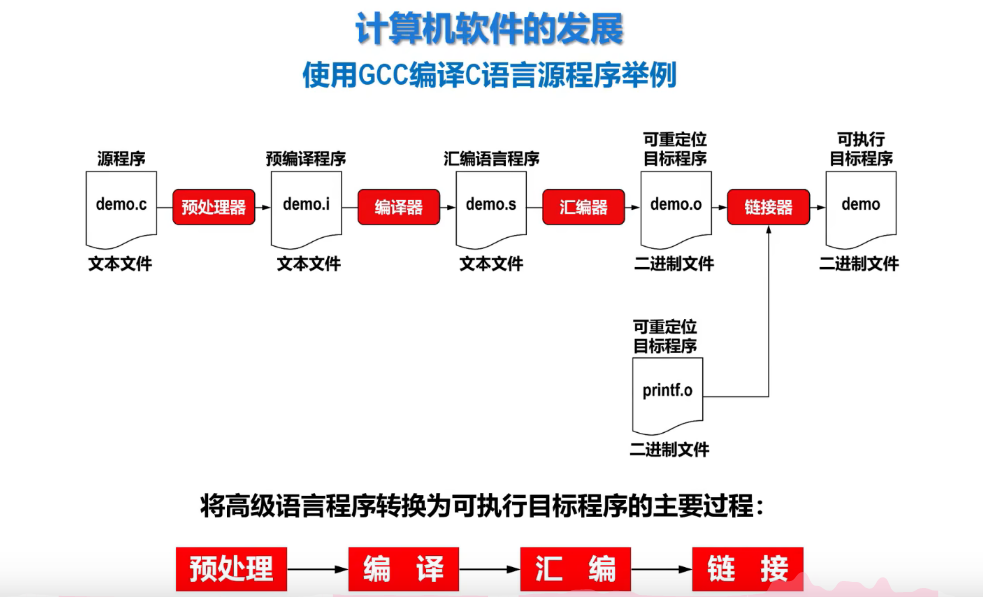

## 一、软件分类

## 二、编程语言（方式）的发展

### 2.1 语言发展

### 2.2 编程语言与翻译语言
#### 2.2.1 关系

**注**
能被计算机直接识别和执行的语言是：机器语言（机器指令）
这句话是正确的，但更深一层来看：
- 被计算机直接**识别**：正确（通过译码器）
- 被计算机直接**执行**：错误，机器语言需要被**译码器**进一步转化成**微指令（微程序**才可以操作硬件）[[1.5 计算机系统的层次]]

#### 2.2.2 使用GCC编译C程序示例

