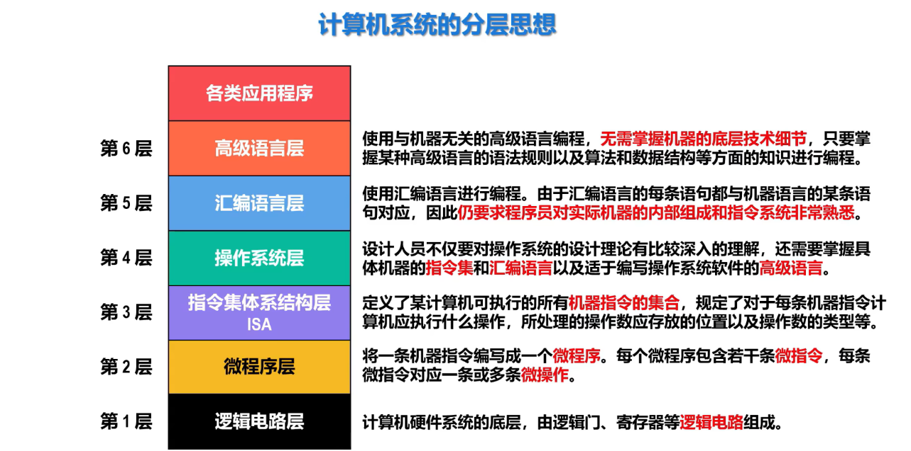
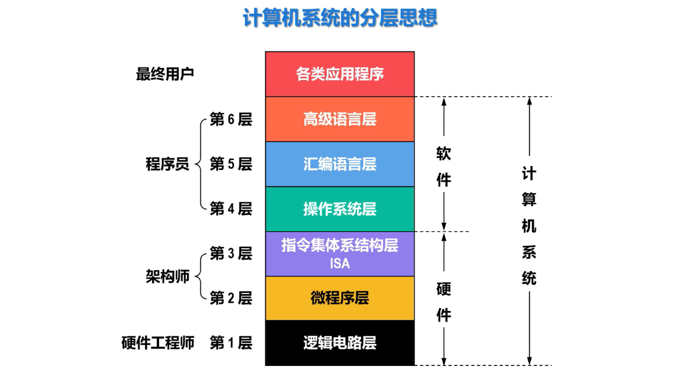
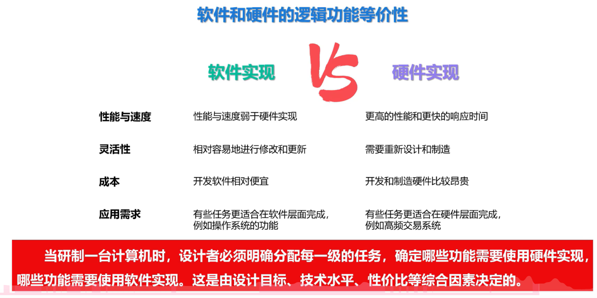

## 一、分层思想

**注释**
- **软硬件的接口**：**指令系统**，其属于硬件层面，可直接控制硬件，同时，其又是程序员（软件层面）可以看到的、硬件可执行指令的集合。一方面，规定了硬件可以做什么，另一方面，也明确了软件层面可以调用什么

**注**
**微程序（微指令**）属于**硬件**层面

---
## 二、软件和硬件的逻辑等价性
### 2.1 定义
 **任何由软件完成的操作，原则上都可以用硬件来实现；反之，任何硬件实现的功能，也可以用软件来模拟**
 
 **注**
 - 软件和硬件所实现的功能，原则上，是可以完全转化的
 - 具体功能由什么层面实现，考量角度如下：
 

### 2.2 408中常考角度：如何选择实现方式

**思路**
- **第一层（理论）** ：从逻辑功能上看，**可以**。因为计算机系统的本质是“功能-实现”分离，任何算法既可写成程序（软件），也可做成逻辑电路（硬件），两者在图灵意义下等价

- **第二层（现实）** ：但在工程上**不全部可行**。硬件实现受限于**芯片面积、功耗、设计周期和灵活性**，过于复杂或易变的功能通常用软件实现（如系统调用、复杂算法）

- **第三层（设计原则）** ：实际系统设计中遵循**“固定频繁用硬件，多变复杂用软件”**的权衡原则，以**性价比**为最终导向

### 2.3软件和硬件的依存关系

**硬件是基础，软件是灵魂，二者在逻辑功能上等价，在物理实现上协同，缺一不可。**
#### 2.3.1  层次化依存：从上到下的解释关系

上层依赖下层，下层对上层提供支持

- **软件依赖硬件**：高级语言（应用层）依赖汇编/机器语言（指令层），机器语言依赖微指令（硬件层）。没有底层的硬件电路，软件就是空中楼阁
    
- **硬件受控于软件**：硬件（CPU、内存）只是被动元件，必须由软件发出的指令序列来驱动，才能完成有意义的数据运算和控制
    

> **408考点**：**“指令系统（ISA）是软硬件之间的交界面”**——常问“下列哪个是软硬件的接口？”，答案：**指令系统**

#### 2.3.2 启动依存：硬件必须由软件“唤醒”

计算机不是一通电就能自己运行操作系统的，它必须依赖一段固化在ROM中的软件来“启动”

- **冷启动过程**：上电 -> 硬件复位 -> CPU自动从ROM的特定地址（如0xFFFF0）取指 -> 执行**BIOS/UEFI固件（固件，属于软件范畴）** -> 加载引导程序（Bootloader） -> 加载操作系统内核