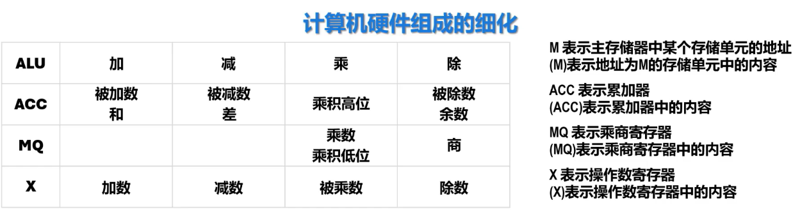
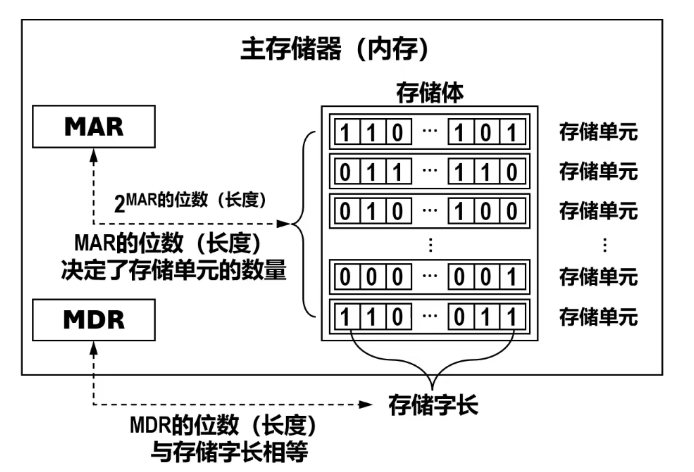
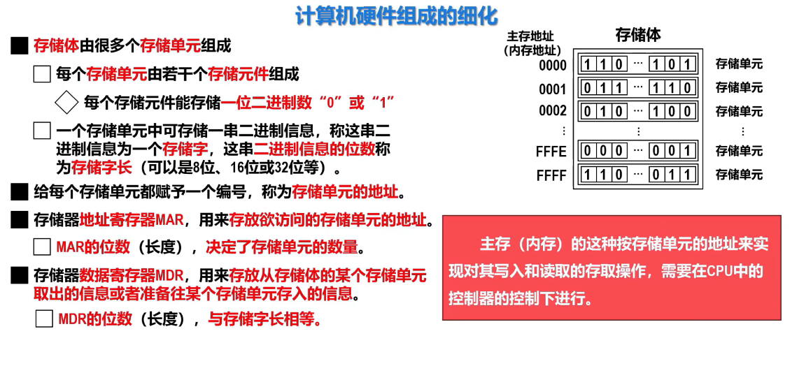
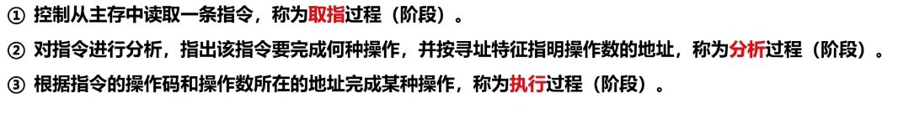
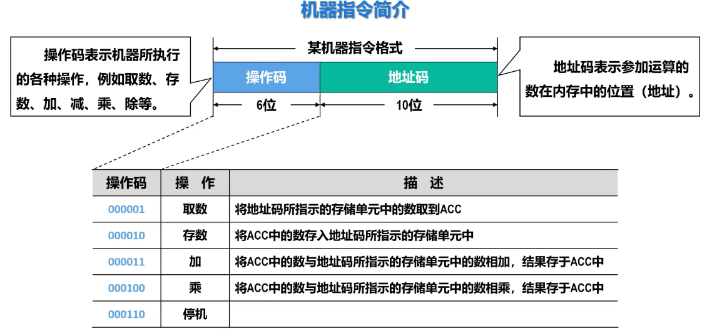
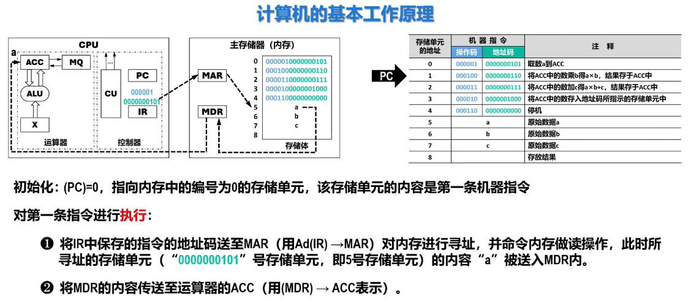

## 一、详解运算器
### 1.1 运算器总览
- ALU：算数逻辑单元
- 寄存器：
  - ACC：累加器
  - MQ：乘商寄存器
  - X：操作数寄存器
为简化，这里只拿运算器中的**算数运算**举例：

### 1.2 详解乘除
#### 1.2.1 乘法的数据流转

假设我们需要计算 `被乘数 × 乘数`，其过程可以拆解为多次“加法-移位”操作。

- **X (操作数寄存器)**：**保存“被乘数”**。乘法开始时，被乘数会从ACC被转移到X中“安顿”好，以便在后续的循环中被反复使用
- **MQ (乘商寄存器)**：**保存“乘数”并辅助存储乘积低位**。乘数从内存被加载到MQ中。在每次循环中，ALU会检查MQ的最低位来决定是否要将X中的被乘数加到ACC上，然后整个 `ACC+MQ` 的组合会向右移一位。移出ACC的最低位会进入MQ的最高位，以此类推。当所有乘法位检查完毕，MQ中最终存储的就是乘积的低位部分
- **ACC (累加器)**：**存放“部分积”和乘积高位**。ACC初始被清零，在乘法循环中不断累加X传过来的被乘数，并参与右移。当运算完成时，ACC中存放的就是乘积的高位部分
在乘法结束时，乘积被存放在 `ACC`（高位）+ `MQ`（低位）的组合中，解决了单次乘法结果可能超出一个寄存器位宽的问题

#### 1.2.2 除法的数据流转

除法可以看作是乘法的逆过程，通过“加减-移位”循环来逐位确定商。假设进行 `被除数 ÷ 除数` 运算：

- **X (操作数寄存器)**：**保存“除数”**。除数从内存被加载到X中，在整个除法过程中保持不变，供ALU进行比较和减法操作
- **ACC (累加器)**：**保存“被除数”和“余数”**。一开始ACC存放被除数，在运算中它存放当前的“余数”（或部分余数），并参与左移操作以产生新的余数。当运算完成时，ACC中保留的是最终的余数
- **MQ (乘商寄存器)**：**存放“商”**。在除法开始时MQ可能为空，随着运算的进行，根据ALU比较余数和除数大小所产生的结果（0或1），会逐位移入MQ，最终在MQ中形成完整的商

总结：**X寄存器定位了一个不变的操作数（被乘数或除数），ACC负责累积结果和中间值（部分积或余数），而MQ则负责“读出”另一个操作数（乘数）并在运算结束后“写入”结果的另一半（乘积低位或商）**

---
## 二、详解主存储器

### 2.1 主存储器组成
- 存储体
- 存储器地址寄存器（MAR）
- 存储器数据寄存器（MDR）

### 2.2 存储体组成

**注**
- **存储单元个数**：2的MAR的位数次幂
- **存储体的存储量（单位b）**:存储单元数量与存储字长的乘积

--- 
## 三、详解控制器（CU、相关寄存器）
### 3.1 控制器组成
- 控制单元CU
- 相关寄存器
  - 程序计数器PC
  - 指令寄存器IR
### 3.2 控制器的工作流

### 3.3 程序计数器PC

- PC存储的是当前**预备执行**的指令的**地址**（注意，不是当前正在执行的指令的地址）
- PC完成提供地址任务后，自动加一，指向下一条预备执行的指令的地址
- PC与主存储器的MAR有一条通路，PC发送给MAR地址，再由MAR完成读取操作
### 3.4 指令寄存器IR

- IR用来存储**当前指令（指令含操作码与地址码）**
- MDR获取MAR读取的内容，而后传给IR
- IR会将当前指令的**操作码**传送给CU，便于完成分析阶段
- IR会将当前指令的**地址码**传送给MAR，由MAR完成读取操作数，然后传给MDR

### 3.5 控制单元CU

**任务**：分析当前指令，并发出若干**微命令**

#### **微命令、微程序、微指令的区分**[[1.5 计算机系统的层次]]

|   术语    |                           定义                           |        408核心属性        |
| :-----: | :----------------------------------------------------: | :-------------------: |
| **微命令** | 控制部件向执行部件发送的**最底层控制信号**（如“打开三态门”“ALU执行加法”），是控制序列的最小单位。 |  **硬件信号**，直接控制数据通路。   |
| **微指令** |      在微程序控制器中，**一组微命令的集合**，存放在控制存储器（CM）的一个存储单元中。       | **固件代码**，是微命令的“打包载体”。 |
| **微程序** |         在微程序控制器中，**一系列微指令的有序集合**，用于解释执行一条机器指令。         |  **固件程序**，是微指令的“序列”。  |

**关系图**（408常考）：

> **微程序**（一个完整的解释程序）由若干条 **微指令**（每条对应一个时钟周期）组成，每条 **微指令** 包含若干个 **微命令**（控制信号）。

---
经典陷阱
##### 陷阱 1：层级混淆——把“微指令”和“微命令”互代

> **错误选项示范**：
> 
> - ❌ “控制存储器（CM）中存放的是微命令。”
>     
> - ❌ “微程序控制器直接向各部件发送微指令。”
>     

> **正确纠错**：
> 
> - ✅ CM中存放的是**微指令**（或微程序），不是微命令。
>     
> - ✅ 微指令经过译码后产生**微命令**，再由微命令控制硬件。CU直接发送的是**微命令**，不是微指令。
>     

##### 陷阱 2：混淆“微程序”和“机器指令程序”

> **错误选项示范**：
> 
> - ❌ “微程序是用户编写的应用程序。”
>     
> - ❌ “一条机器指令对应一条微指令。”
>     

> **正确纠错**：
> 
> - ✅ 微程序是**硬件设计者**编写的，用于解释执行机器指令，属于**固件**，不属于用户软件。
>     
> - ✅ 一条机器指令对应**一个微程序**（包含多条微指令），而不是一条微指令。例如一条乘法机器指令可能对应几十条微指令。
>     

##### 陷阱 3：把“微程序控制器”归类为软件实现

> **错误选项示范**：
> 
> - ❌ “微程序控制器采用软件方式实现控制功能，因此灵活性高但速度慢。”
>     

> **正确纠错**：
> 
> - ✅ 微程序控制器是**硬件实现方式**，虽然其设计思路像“编程”，但在408考纲中属于**硬件**。可以表述为“采用**存储逻辑**（固件）实现”，但不能说成“软件实现”。软件指的是编译后的机器指令程序，两者层次不同。
>     

---
### 3.6 机器指令

#### 3.6.1 组成

### 3.7 取指、分析、执行全流程

可据此图分析

