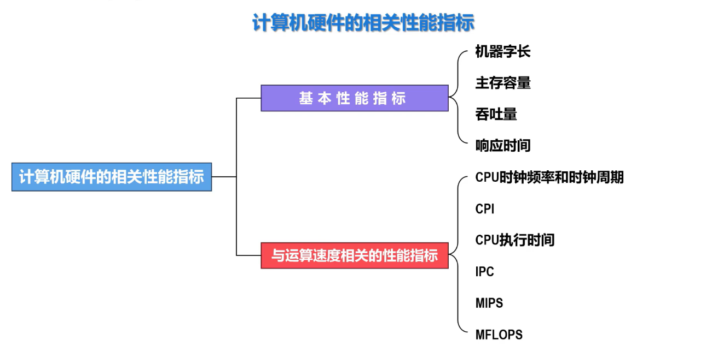
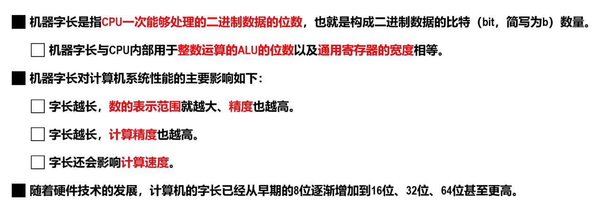
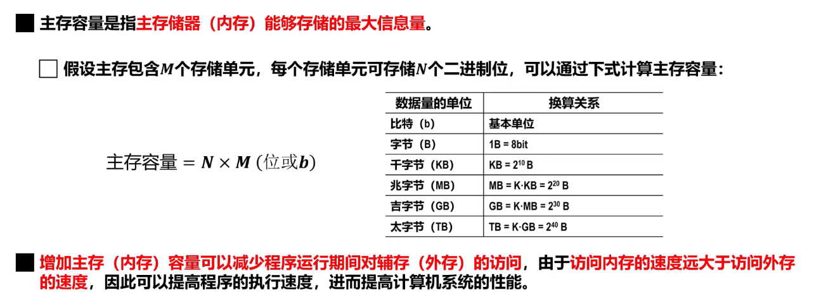
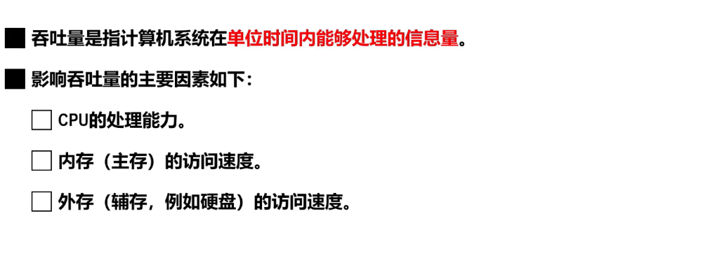
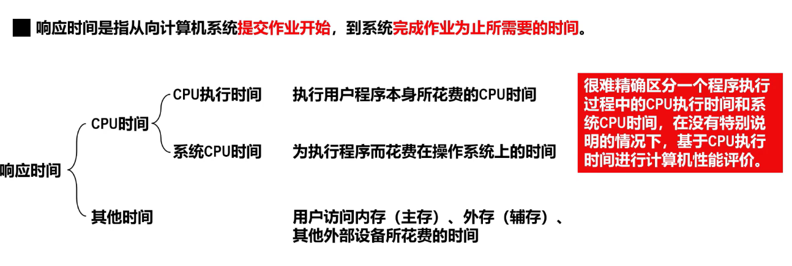
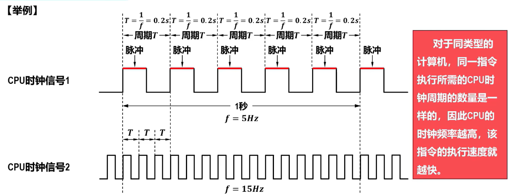
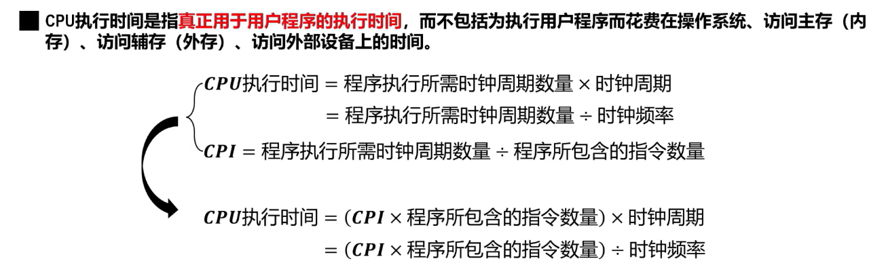
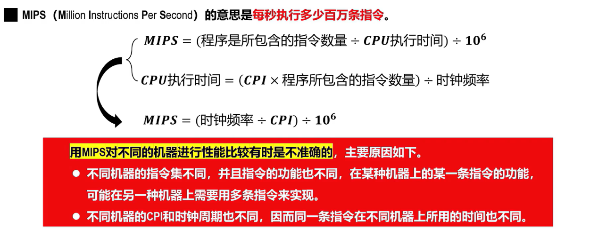
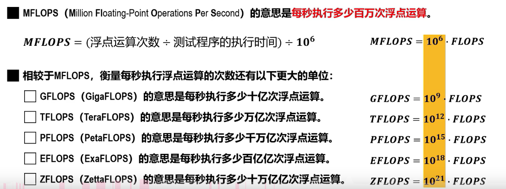

## 一、硬件指标

## 二、基本性能指标

### 2.1 机器字长

### 2.2 主存容量

[[1.6 计算机基本工作原理]]
### 2.3 吞吐量

### 2.4 响应时间

## 三、与运算速度相关的性能指标

### 3.1 CPU时钟周期（秒s）、时钟频率(赫兹Hz)

### 3.2 CPI(circles pre instruction)

**定义**：执行一条指令所需的时钟周期

一个程序的CPI计算方式：
- 方式一：该程序所需的时钟周期的数量除以该程序中指令的数量
- 方式二：

### 3.3 CPU执行时间

### 3.4 IPC（instructions pre circle)

定义：每周期可执行的指令数量（显然为PCI的倒数）

###  3.5MIPS(million instructions pre second)

定义：每秒可执行多少百万条指令

### MFlops(million floating-point-operations pre second)

定义：每秒可执行多少百万次浮点数运算
